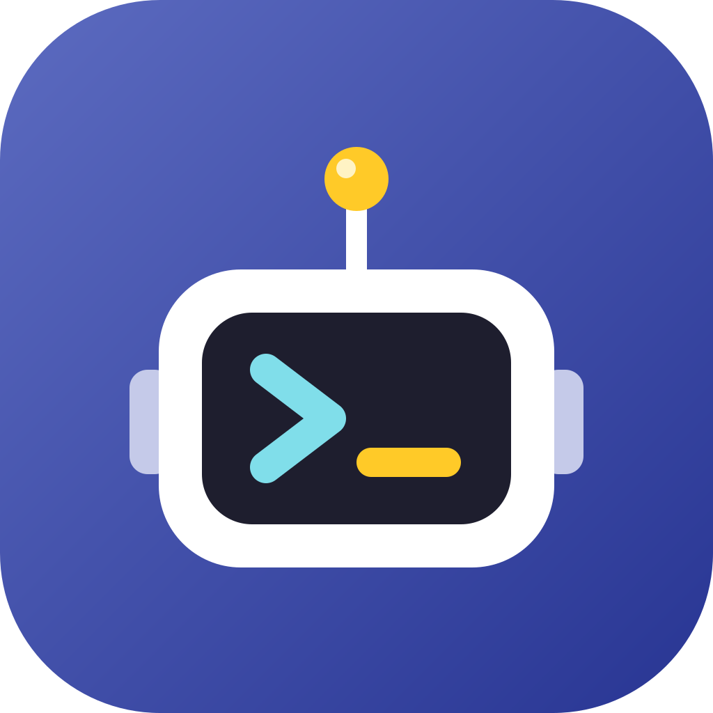

# prog_trainer

Eine Handy-App zum Programmierenlernen, auch für komplette Anfänger.
Zum Start gibt es **Python** und **C#**. Später kommen weitere Sprachen dazu,
außerdem Themen wie **Software-Architektur**, **Testing** und
**Requirements Engineering**.

Gebaut mit [Flutter](https://flutter.dev) (Android & iOS).

📖 **Doku & Download:** https://bac-htl.github.io/prog_trainer/  
📦 **Aktuelle APK:** [Releases → latest](https://github.com/BAC-HTL/prog_trainer/releases/tag/latest)

## App aufs Handy bekommen (ohne eigenen Build)

Am einfachsten über die Doku-Seite oben. Zusätzlich baut GitHub Actions bei jedem Push eine Test-APK:

1. Im Repo auf **Actions** → den neuesten Lauf von „Flutter CI“ öffnen.
2. Unten bei **Artifacts** `prog_trainer-apk` herunterladen und entpacken.
3. `app-debug.apk` auf dem Android-Handy öffnen und installieren
   (eventuell „Installation aus unbekannten Quellen“ erlauben).

## Lokal entwickeln

1. [Flutter installieren](https://docs.flutter.dev/get-started/install).
2. Einmalig die Plattform-Ordner erzeugen:
   ```bash
   flutter create --platforms=android,ios --project-name prog_trainer .
   ```
3. Starten:
   ```bash
   flutter pub get
   flutter run
   ```
4. Tests: `flutter test`

## Projektstruktur

```
lib/
  main.dart                 Einstiegspunkt
  models/content.dart       Datenmodelle (Track, Lesson, QuizQuestion)
  data/content_repository.dart   lädt die JSON-Inhalte
  screens/                  Startseite, Lernpfad, Lektion, Quiz
  widgets/                  wiederverwendbare Bausteine (Code-Box, Icons)
assets/content/
  index.json                Liste aller Lernpfade
  python/, csharp/          Lektionen als JSON
test/                       Tests (inkl. Prüfung aller Inhaltsdateien)
```

## Neue Inhalte hinzufügen

Für Inhalte muss kein Dart-Code angefasst werden:

1. Eine neue Lektion als JSON-Datei anlegen, z. B. `assets/content/python/03_bedingungen.json`
   (die vorhandenen Dateien dienen als Vorlage).
2. Den Pfad in `assets/content/index.json` beim passenden Lernpfad unter `lessons` eintragen.
3. **Neuer Ordner** (z. B. neue Sprache)? Dann den Ordner zusätzlich in
   `pubspec.yaml` unter `flutter: assets:` eintragen.
4. `flutter test` prüft, ob alles gültig ist.

## Lizenz

Veröffentlicht unter der [MIT-Lizenz](LICENSE).
