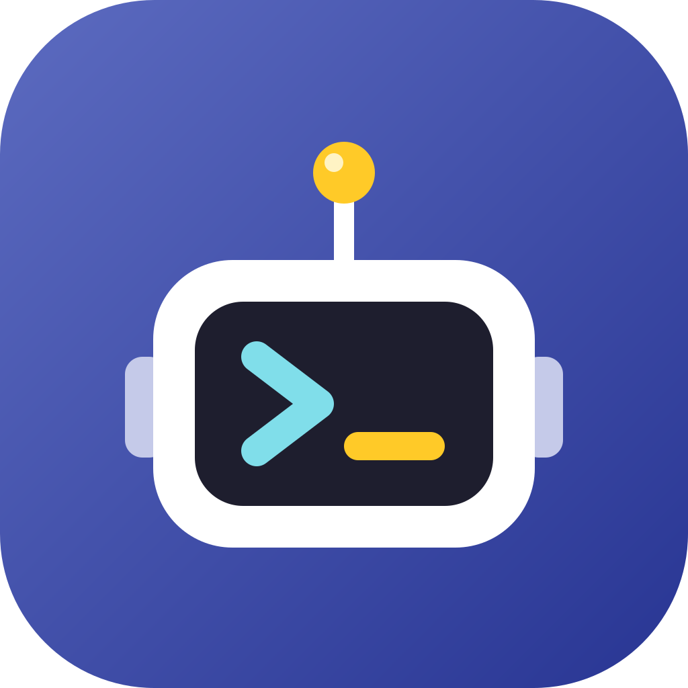

# Prog Trainer

{ width="140" align=right }

Eine Lern-App für **Android, iOS und den Browser** zum Programmierenlernen. Sie fängt bei
null an und führt in **Python** und **C#** bis zum Senior-Level.

## Download

[:material-web: Im Browser starten](https://bac-htl.github.io/prog_trainer/app/){ .md-button .md-button--primary }
[:material-android: Android (APK)](https://github.com/BAC-HTL/prog_trainer/releases/download/latest/prog_trainer.apk){ .md-button }
[:material-apple: iOS (IPA, unsigniert)](https://github.com/BAC-HTL/prog_trainer/releases/download/latest/prog_trainer-unsigned.ipa){ .md-button }

Beide Dateien werden bei jeder Änderung auf `main` automatisch neu gebaut
und liegen auch unter
[Releases](https://github.com/BAC-HTL/prog_trainer/releases/tag/latest).
Wie man sie installiert, steht unter [Installation](installation.md).

## Funktionen

- **Lehrplan der HTL für Informatik.** Die Inhalte sind nach Jahrgang (1.–5.) und Fach gegliedert: Programmieren (POS), Datenbanken (DBI), Netzwerke (NVS), Technische Informatik (TINF) und Projektentwicklung (SYP). Danach folgen die Stufen **Junior, Senior und Expert**. [Zum Lehrplan](lehrplan.md)
- **Nicht nur Programmieren.** Es gibt auch Module zu Netzwerken, Datenbanken, Hardware, Web, Logik, UML und Office.
- **Themenfilter.** Du kannst nach Stufe, Fach und Thema filtern.
- **Python und C#.** Programmier-Module gibt es in beiden Sprachen. Beide laufen direkt am Handy, ohne Anmeldung.
- **Lektionen.** Jede Lektion hat Erklärungen, Beispiele und ein Quiz mit sofortigem Feedback.
- **Abschlussprüfung pro Modul.** Ab 70 % ist sie bestanden, und es gibt ein **PDF-Zertifikat** mit deinem Namen.
- **Herausforderungen.** Du schreibst echten Code, der ausgeführt und gegen Testfälle geprüft wird. Punkte gibt es pro Sprache getrennt.
- **Spielmodus „Expedition Xeno-7“.** Du steuerst einen Forschungsroboter mit echtem Code. [Mehr dazu](spiel.md)
- **Achievements** für Meilensteine.

## Stand der Inhalte

| Stufe | Stand |
|---|---|
| 1.–3. Jahrgang | ✅ alle Fächer ausgearbeitet |
| 4. und 5. Jahrgang | Lehrplan angelegt, Inhalte folgen |
| Junior, Senior, Expert | Module angelegt, Inhalte folgen |
| Herausforderungen | 24 pro Sprache |
| Spielmissionen | 16 pro Sprache |

## Lizenz

Der Quellcode und die Lerninhalte stehen unter der [MIT-Lizenz](https://github.com/BAC-HTL/prog_trainer/blob/main/LICENSE).
